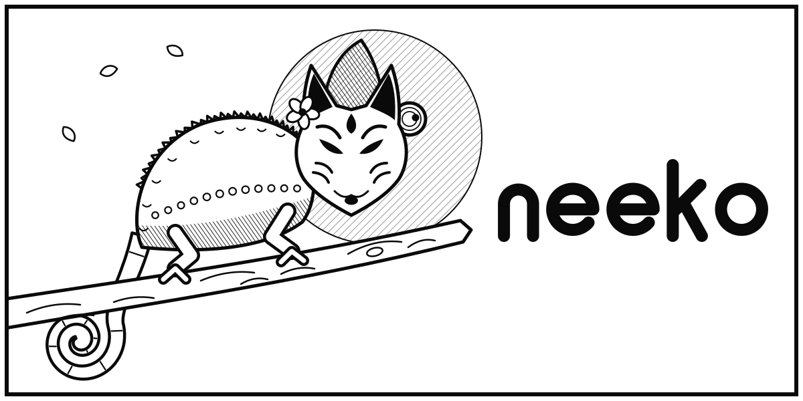

<div align="center">



# neeko

**Build any browser UI you want in plain HTML, CSS and JS. Firefox does the rest.**<br>
*Firefox underneath, any face on top.*

</div>

---

Neeko is a framework on top of Firefox. It hides Firefox's own interface and
lets you draw your own (a diagonal tab bar, a circular address bar, anything)
with ordinary web code. A bridge API connects that UI to Firefox's real
features, and anything your UI doesn't handle yet falls back to a working
default, so a browser built on Neeko is always complete.

## Status

Early foundation work. Right now this repo builds and runs stock Firefox
156.0.1 through [Surfer](https://github.com/zen-browser/surfer). Neeko's UI
layer and API come next.

## Requirements

- macOS on Apple Silicon (Linux and Windows builds are untested so far)
- Xcode, [bun](https://bun.sh), and GNU tar (`brew install gnu-tar`)
- About 10 GB of free disk for the Firefox source and build

## Usage

```sh
make
```

The first run installs dependencies, downloads the Firefox source into
`engine/`, builds it, and launches it with a throwaway dev profile. That takes
about 15 minutes, mostly unpacking Firefox and snapshotting it into git. After
that, a rebuild takes under a minute.

| Command       | What it does                                       |
| ------------- | -------------------------------------------------- |
| `make`        | Set up if needed, build, and launch                |
| `make build`  | Build only                                         |
| `make update` | Quit a running dev build, rebuild, and relaunch it |

## How it works

Surfer (the tool Zen Browser uses to build its Firefox fork) downloads the
Firefox release pinned in `surfer.json`, applies this repo's changes to it, and
drives Firefox's own build tool.

Builds are **artifact builds**: instead of compiling Firefox's C++ and Rust
(hours), the build downloads Mozilla's prebuilt binaries for the exact same
release and only builds the frontend layer locally (minutes). Neeko works
entirely in that frontend layer. Set `NEEKO_FULL_BUILD=1` to compile
everything from source instead.

Because of artifact builds, the program inside the app bundle keeps the name
`firefox`. The app's visible name and its profile folder are "Neeko", so dev
builds never touch a regular Firefox profile.

```
neeko/
├── surfer.json   Firefox version pin and app name
├── configs/      Build settings Surfer merges into engine/mozconfig
├── src/          Neeko's own files and patches, layered onto engine/ (empty for now)
├── docs/         Research notes (so far: what Firefox connects to)
├── assets/       README artwork
├── Makefile
└── engine/       Firefox source, downloaded by Surfer (not committed)
```

## License

Firefox is licensed under the [MPL-2.0](https://www.mozilla.org/MPL/2.0/).
