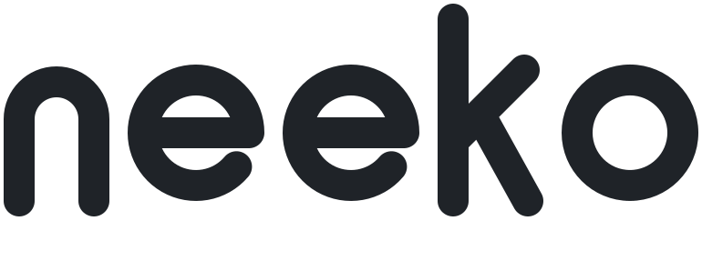

<div align="center">

<picture>
  <source media="(prefers-color-scheme: dark)" srcset="assets/icon-butterfly.svg" />
  
</picture>
<br>
<picture>
  <source media="(prefers-color-scheme: dark)" srcset="assets/wordmark-dark.svg" />
  
</picture>

**Build any browser UI you want in plain HTML, CSS and JS. Firefox does the rest.**<br>
*Firefox underneath, any face on top.*

</div>

---

Neeko is a framework on top of Firefox. It hides Firefox's own interface and
lets you draw your own (a diagonal tab bar, a circular address bar, anything)
with ordinary web code. A bridge API connects that UI to Firefox's real
features, and anything your UI doesn't handle yet falls back to a working
default, so a browser built on Neeko is always complete.

## Status

Early foundation work, on Firefox 156.0.1. Neeko hides Firefox's interface,
loads a custom UI with the web page placed wherever that UI says, and gives
the UI a small JavaScript API for tabs, navigation, permission prompts,
fullscreen and downloads. `ui/` holds a deliberately plain demo UI built
only on that API: a tab list, back, forward and reload, an address bar, a
bar for permission prompts, a downloads list, and a layout that steps aside
for fullscreen videos. A browser built on Neeko keeps Neeko as a
submodule and brings its own UI, name and icon, and `make release` turns it
into a packaged app with its own identity.

## Requirements

- macOS on Apple Silicon (Linux and Windows builds are untested so far)
- Xcode, [bun](https://bun.sh), and GNU tar (`brew install gnu-tar`)
- [uv](https://docs.astral.sh/uv/), only for the privacy test
- About 10 GB of free disk for the Firefox source and build

## Usage

```sh
make
```

The first run installs dependencies, downloads the Firefox source into
`engine/`, builds it, and launches it with your UI from `ui/` and a throwaway
dev profile. That takes about 15 minutes, mostly unpacking Firefox and
snapshotting it into git. After that, a rebuild takes under a minute.

| Command        | What it does                                             |
| -------------- | -------------------------------------------------------- |
| `make`         | Set up if needed, build, and launch                      |
| `make build`   | Build only                                               |
| `make update`  | Quit a running dev build, rebuild, and relaunch it       |
| `make release` | Full build from source, packaged into `dist/` (hours)    |

## Starting a browser

Your browser lives in its own repo, with Neeko inside it as a pinned git
submodule, so updating Neeko (and Firefox with it) never conflicts with your
work:

```sh
bun tools/new-browser.ts ../mybrowser --name MyBrowser
cd ../mybrowser && make
```

That repo holds `browser.json` (name, vendor, app id, version), `ui/` (a copy
of the demo UI to start from), `branding/` (`prefs.js`, and `icon.png` when
you have one), and a Makefile that hands everything to `neeko/`.
[docs/using-neeko.md](docs/using-neeko.md) explains how it all fits, how to
update Neeko, and how releases work. Neeko's own repo is built the same way:
its `browser.json`, `ui/` and `branding/` are the demo app.

## Building a UI

Your UI is an ordinary web page: `ui/index.html` plus whatever CSS and JS it
loads. Neeko shows it in place of Firefox's interface, filling the window.
Dev launches load it straight from `ui/`, so changes only need a relaunch,
not a rebuild. Builds also bundle it inside the app, which is what packaged
browsers use.

- Mark the element where the website should appear with
  `data-neeko-content`. Neeko keeps the real page on top of it, matching its
  position, size and corner rounding, and follows it when it moves or
  animates.
- On macOS, the window's close, minimize and zoom buttons appear wherever you
  put an element with `data-neeko-window-buttons`.
- Your scripts get a global `neeko` object, the Neeko API: list, open, close
  and switch tabs, navigate, answer sites' permission requests, lay out
  fullscreen, follow and manage downloads, and hear about every change. It's documented in
  [docs/api.md](docs/api.md), and `ui/app.js` shows all of it in use.
- Scripts must be separate files (the page's security policy blocks inline
  scripts). They load from `chrome://neeko-ui/content/`, which maps to `ui/`.
  File names may only use letters, digits and `. _ - @ +`.
- If an app has no `ui/index.html`, Neeko stays out of the way and Firefox
  looks as usual. Pop-up windows, such as sign-in pop-ups, keep Firefox's
  minimal UI.

## Testing

After `make build`:

```sh
python3 tools/test_api.py       # every API call and event, and the bundled UI, 10 seconds
python3 tools/test_privacy.py   # every connection a fresh profile makes, about 6 minutes
```

The privacy test runs the browser through mitmproxy (fetched by `uvx`, so
[uv](https://docs.astral.sh/uv/) is the only extra requirement) and fails if
anything reaches an endpoint Neeko turns off. Run it after every Firefox
update.

After `make release`, `python3 tools/test_release.py` checks the packaged app
is its own browser (its own name and profile folder, telemetry compiled out,
Neeko's prefs packaged), and both tests above take `--app dist/Neeko.app` to
run against it. Release builds want 16 GB of memory or more for full
optimization; on smaller machines `make release` skips Rust link-time
optimization so the build can finish.

## How it works

Surfer (the tool Zen Browser uses to build its Firefox fork) downloads the
Firefox release pinned in `neeko.json`, applies this repo's changes to it, and
drives Firefox's own build tool. Before it runs, `tools/app.ts` turns the app
folder (`browser.json`, `ui/`, `branding/`) into Surfer's `surfer.json` and a
Firefox branding folder, so the build carries the app's name, icon, prefs,
version and UI.

Builds are **artifact builds**: instead of compiling Firefox's C++ and Rust
(hours), the build downloads Mozilla's prebuilt binaries for the exact same
release and only builds the frontend layer locally (minutes). Neeko works
entirely in that frontend layer. Set `NEEKO_FULL_BUILD=1` to compile
everything from source instead.

Neeko uses **hide and plug**. Firefox keeps running exactly as it is, logic
and all, so tabs, extensions, session restore and prompts all keep working.
Neeko hooks into Firefox's official per-window startup hook, before the
window is first drawn, and does four things:

1. It hides Firefox's toolbars and sidebar. The elements are never laid out or
   painted, which in a 300-tab test made opening tabs faster than stock
   Firefox, with no measurable difference in memory or tab switching.
2. It mounts your UI in a frame filling the window.
3. It places Firefox's real page area over your content slot.
4. It gives your UI the `neeko` API. Every call is a message to Firefox, so
   UIs will later be able to run sandboxed without changing their code.

Neeko changes two Firefox files, each by a few clearly marked lines: one adds
Neeko's folder to the build (`src/browser/moz-build.patch`), and one adds
Neeko's pref files to the list of files packaged builds include
(`src/browser/installer/package-manifest-in.patch`).

Because of artifact builds, the program inside a dev build keeps the name
`firefox`, and Mozilla's prebuilt launcher still reports itself as Firefox.
That means a dev build started on its own would use your regular Firefox
profile folder, so always start it with `make` (or the test tools), which
give it a separate profile. Release builds (`make release`) compile the
launcher too, so they carry the app's own name and profile folder.

Privacy is on by default: nothing is sent to Mozilla for telemetry, studies,
ads or crash reports, from the first launch, in every browser built on Neeko.
`src/browser/neeko/firefox-neeko-privacy.js` holds those defaults.
[PRIVACY.md](PRIVACY.md) lists every connection that's left and why, in
plain language, and [docs/privacy/](docs/privacy/implementation.md) has the
details.

```
neeko/
├── neeko.json    The Firefox release Neeko is built on
├── browser.json  The demo app's identity: name, vendor, app id, version
├── ui/           The demo UI (a browser brings its own)
├── branding/     The demo app's icon and prefs
├── configs/      Build settings Surfer merges into engine/mozconfig
├── src/          Neeko's own files, layered onto engine/ by Surfer
│   └── browser/
│       ├── neeko/            Window hook, API, hide styles, prefs, privacy defaults
│       ├── moz-build.patch   Adds neeko/ to the build
│       └── installer/        Adds Neeko's prefs to packaged builds
├── docs/         API reference, using Neeko in a browser, privacy research,
│                 lessons learned, history
├── tools/        The app step (app.ts), the starter (new-browser.ts), tests
├── assets/       README artwork
├── Makefile
├── engine/       Firefox source, downloaded by Surfer (not committed)
└── dist/         Release packages from make release (not committed)
```

## More

- [ARCHITECTURE.md](ARCHITECTURE.md): how the layers connect, and why.
- [ROADMAP.md](ROADMAP.md): the API features coming next, in order.
- [PRIVACY.md](PRIVACY.md): every connection a browser built on Neeko makes,
  in plain language.
- [CLAUDE.md](CLAUDE.md): the rules for working on Neeko.
- [docs/lessons.md](docs/lessons.md): Firefox and tooling traps.

## License

Firefox is licensed under the [MPL-2.0](https://www.mozilla.org/MPL/2.0/).
